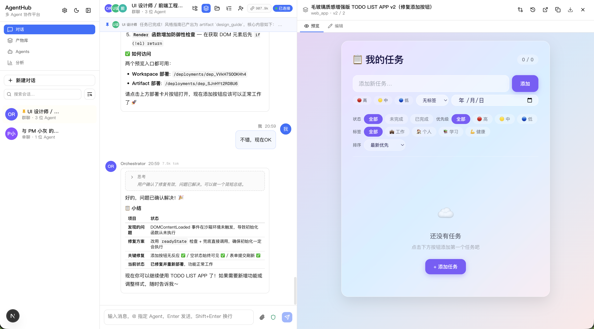

# AgentHub

<p align="center">
  
  
  
  
  
  
</p>

<p align="center">
  <b>English</b> · <a href="./README.zh-CN.md">简体中文</a>
</p>

AgentHub is a local-first multi-agent workspace that turns AI collaboration into an IM-style experience.

AgentHub organizes work around conversations. A conversation has its own workspace, files and artifacts provide shared context, and the Orchestrator delegates work to specialists as needed.

<p align="center">
    
</p>

> Current status: active local development. The app is usable as a web app and Electron desktop app; the mobile companion app is under development.

## Contents

- [Why AgentHub](#why-agenthub)
- [Features](#features)
  - [IM-style agent workspace](#im-style-agent-workspace)
  - [Multi-agent support](#multi-agent-support)
  - [Orchestrator and task dispatch](#orchestrator-and-task-dispatch)
  - [Artifacts and deployment previews](#artifacts-and-deployment-previews)
- [Tech Stack](#tech-stack)
- [Requirements](#requirements)
- [Quick Start](#quick-start)
  - [Langfuse tracing](#langfuse-tracing)
- [Desktop App](#desktop-app)
  - [Specify Electron build platform](#specify-electron-build-platform)
- [Mobile Companion](#mobile-companion)
- [Common Commands](#common-commands)
- [Architecture](#architecture)
- [Security Model](#security-model)
- [Known Limits](#known-limits)
- [Contributing](#contributing)

---

## Why AgentHub

Modern coding agents are powerful, but real work often needs more than one prompt:

- keep multiple conversations and workspaces alive
- route work to different agents and models
- inspect reasoning, tool calls, file writes, command output, and artifacts
- approve risky changes before they touch the workspace
- continue from desktop, and eventually monitor from a phone

AgentHub is built for that workflow. It is local by default, uses SQLite, and keeps agent execution on your own machine.

---

## Features

### IM-style agent workspace

- Conversation list, lead-driven group chats, unread state, bookmarks, pins, reply quoting, edit-and-resend, withdraw, and regenerate.
- Messages render text, code, tool calls, attachments, artifact references, deployments, and delegation cards as separate parts.
- Tool calls are visible in the chat stream, including long bash commands and command output.
- Agent model requests include the host's current local time and UTC offset.

### Multi-agent support

| Adapter | Use case |
| --- | --- |
| Claude Code | Uses the Anthropic Python SDK and AgentHub's tools. Requires an Anthropic or compatible API key. |
| Custom Agent | OpenAI Chat Completions-compatible providers such as OpenAI, DeepSeek, Volcano Ark, OpenRouter, SiliconFlow, and other compatible endpoints. |
| Mock | Local development without spending tokens. |

You can create custom agents in the UI with their own model, provider, system prompt, base URL, API key, and tool set.

### Orchestrator and task dispatch

The Orchestrator receives group messages and is the group's direct responder. It can ask clarification questions and propose one assignment at a time. Approve, reject, or request changes from the assignment card in the chat. FastAPI uses LangGraph to run approved assignments and return each worker's result and artifact references to the Orchestrator before it decides what to do next.

### Workspace, files, and approvals

- Each conversation has a workspace.
- Sandbox mode stores files under `.agenthub-data/workspaces/<conversationId>`.
- Local mode binds a conversation to a real local project directory.
- `fs_read`, `fs_write`, and `bash` are constrained to the effective workspace directory.
- Review mode can require approval before file writes.
- The command blacklist blocks dangerous shell patterns.

### Artifacts and deployment previews

Agents can create and reference structured artifacts:

- `web_app`: sandboxed iframe preview
- `document`: markdown rendering
- `image`: image preview
- `ppt`: slide preview and real `.pptx` export
- `code_file`: workspace file reference
- `diff`: version comparison

For local frontend projects, agents can deploy static output directories such as `dist`, `build`, `out`, or `client/dist` into a local preview card.

### Desktop and mobile

- Electron desktop packaging is supported.
- A Capacitor mobile companion app lives in `apps/mobile`.
- The intended mobile workflow is companion-client style: phone connects to the desktop AgentHub host over LAN or Tailscale, then observes runs, sends messages, and handles approvals.

---

## Tech Stack

- Next.js 16 App Router + React 19
- TypeScript strict mode
- Tailwind CSS v4 + shadcn/ui
- Zustand + Immer
- FastAPI with Python's `sqlite3`
- LangGraph for delegation and approval, with optional Langfuse tracing
- SSE for live updates
- Electron 33 for desktop packaging
- Capacitor for the mobile companion app
- pnpm workspaces

Next.js is pinned to `16.2.6`. If you modify framework-level behavior, read the local Next docs in `node_modules/next/dist/docs/` first.

---

## Requirements

- Node.js 20+
- pnpm
- Python 3.11+ and uv
- macOS or Windows for the desktop app path
- Xcode and CocoaPods only if you work on the iOS companion app

Optional provider setup:

- API keys for Anthropic, OpenAI, DeepSeek, Volcano Ark, or custom OpenAI-compatible providers

---

## Quick Start

```bash
pnpm install --frozen-lockfile
uv --directory backend sync --locked --extra dev

# Optional
cp .env.example .env.local

# Run Next.js and FastAPI
pnpm dev
```

Open:

```text
http://localhost:3000
```

On Windows PowerShell, use `Copy-Item .env.example .env.local` to create the optional config file. The backend creates the SQLite database and seeds the built-in agents on first startup.

You can configure API keys either in `.env.local` or in the app settings panel. Agent-specific keys override global settings.

Common env vars:

```bash
ANTHROPIC_API_KEY=...
OPENAI_API_KEY=...
DEEPSEEK_API_KEY=...
ARK_API_KEY=...
```

### Langfuse tracing

Copy the project keys and region URL from Langfuse into `.env.local` or the FastAPI process environment. This example uses Langfuse Cloud US.

```dotenv
LANGFUSE_PUBLIC_KEY=
LANGFUSE_SECRET_KEY=
LANGFUSE_BASE_URL=https://us.cloud.langfuse.com
# LANGFUSE_CAPTURE_CONTENT=true
```

Restart FastAPI and send a new message. **Tracing** shows the run, model calls, tool execution, delegation reviews, and worker runs with their timings, statuses, and token usage. **Sessions** groups traces by conversation.

Set `LANGFUSE_CAPTURE_CONTENT=true` to include text previews of prompts, replies, tool arguments, and tool results in new observations. Previews redact known credentials and omit binary attachments and private reasoning. Set `LANGFUSE_TRACING_ENABLED=false` to disable export.

---

## Desktop App

Development mode:

```bash
pnpm electron:dev
```

Default package command:

```bash
pnpm electron:build
```

Output goes to:

```text
release/
```

The current `package.json#build` config targets:

- macOS: `dmg`, `arm64`
- Windows: `nsis`, `x64`

### Specify Electron build platform

`pnpm electron:build` is a convenience script. If you want to choose the exact platform/arch, run the same prebuild pipeline and call `electron-builder` with platform flags:

```bash
# macOS arm64 DMG
pnpm build && pnpm electron:prebuild && pnpm electron:tsc && pnpm exec electron-builder --mac dmg --arm64

# macOS x64 DMG
pnpm build && pnpm electron:prebuild && pnpm electron:tsc && pnpm exec electron-builder --mac dmg --x64

# Windows x64 NSIS installer
pnpm build && pnpm electron:prebuild && pnpm electron:tsc && pnpm exec electron-builder --win nsis --x64
```

Short forms also work when you are calling `electron-builder` directly:

```bash
pnpm exec electron-builder -m --arm64
pnpm exec electron-builder -w --x64
```

The desktop frontend uses the same FastAPI backend. Start the backend separately when running the packaged frontend.

---

## Mobile Companion

Mobile app workspace:

```bash
apps/mobile
```

Useful commands:

```bash
pnpm mobile:dev
pnpm mobile:build
pnpm mobile:sync
pnpm mobile:open:ios
pnpm mobile:open:android
```

The mobile app is designed to connect to a desktop AgentHub host over LAN or Tailscale. Agent execution, file writes, command execution, and workspace state remain on the desktop side.

---

## Common Commands

```bash
pnpm dev                 # Next.js and FastAPI development servers
pnpm backend:dev         # FastAPI development server on port 8000
pnpm backend:test        # Python backend tests
pnpm typecheck           # TypeScript check
pnpm lint                # ESLint
pnpm test                # Vitest
pnpm e2e                 # Playwright E2E
pnpm build               # Next.js production build
pnpm start               # Start Next.js against a running FastAPI backend
pnpm electron:dev        # Desktop development mode
pnpm electron:build      # Desktop package
```

Local data:

```text
.agenthub-data/agenthub.db
.agenthub-data/workspaces/
```

Packaged desktop data:

```text
macOS:   ~/Library/Application Support/AgentHub/data
Windows: %APPDATA%/AgentHub/data
```

---

## Architecture

AgentHub follows a five-layer structure:

```text
L5 UI
  React components, shadcn/ui, message/artifact rendering

L4 State + Transport
  Zustand store, SSE client, reducers for StreamEvent

L3 Application Services
  AgentRunner, ConversationService, EventBus, ToolExecutor

L2 Agent Platform Adapters
  Anthropic, Custom OpenAI-compatible adapter, Mock

L1 Persistence
  SQLite and workspace filesystem, managed by FastAPI
```

The central contract is `StreamEvent`. Adapter output, tool activity, artifact creation, pending approvals, dispatch state, and usage updates flow through this event model before reaching the UI.

Key docs:

- [CLAUDE.md](./CLAUDE.md): project rules for AI collaborators
- [OVERVIEW.md](./OVERVIEW.md): codebase map and current implementation status
- [openspec/project.md](./openspec/project.md): OpenSpec capability index
- [specs/](./specs): detailed numbered specs

---

## Security Model

AgentHub assumes LLM output is untrusted.

- File tools resolve paths under the conversation effective workspace.
- Bash commands run inside the workspace cwd.
- Dangerous bash patterns are blocked.
- Generated web app artifacts render in sandboxed iframes.
- API keys are local settings or environment variables; there is no hosted key service.

This is a local single-user app, not a multi-tenant hosted service.

---

## Known Limits

- Linux desktop packaging is not configured yet.
- The FastAPI backend has a placeholder for the Codex adapter. Use a supported Anthropic or OpenAI-compatible adapter for agent runs.
- The mobile app is a companion client, not a standalone agent runtime.

---

## Contributing

Before making code changes, read:

1. [CLAUDE.md](./CLAUDE.md)
2. [openspec/project.md](./openspec/project.md)
3. Relevant files under [openspec/specs](./openspec/specs) and [specs](./specs)

When changing entities, stream events, tools, adapters, persistence, platform behavior, or security rules, update code and specs together.

---

## License

AGPL-3.0-only. See [LICENSE](./LICENSE).
