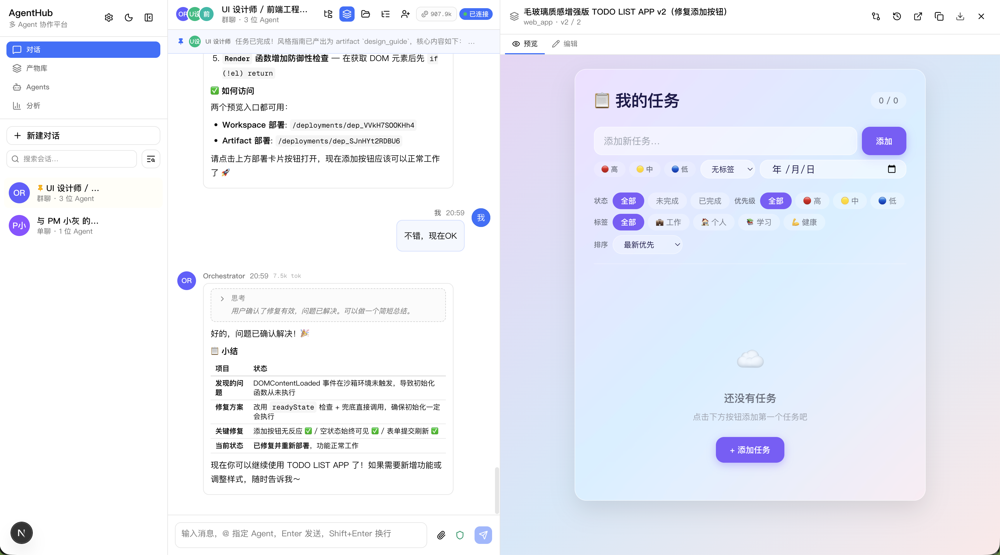

# AgentHub

<p align="center">
  
  
  
  
  
  
</p>

<p align="center">
  <a href="./README.md">English</a> · <b>简体中文</b>
</p>

AgentHub 是一个 local-first 的多 Agent 协作工作空间，把 AI 协作做成 IM 群聊式的体验。

AgentHub 围绕会话组织工作。每个会话有独立的工作空间，文件和产物提供共享上下文，Orchestrator 按需把任务交给不同的 Agent。

<p align="center">
    
</p>

> 当前状态：本地开发中。Web 版与 Electron 桌面版已可用；移动伴随端开发中。

## 目录

- [为什么选 AgentHub](#为什么选-agenthub)
- [功能特性](#功能特性)
  - [IM 式 Agent 工作空间](#im-式-agent-工作空间)
  - [多 Agent 支持](#多-agent-支持)
  - [Orchestrator 与任务调度](#orchestrator-与任务调度)
  - [产物与部署预览](#产物与部署预览)
- [技术栈](#技术栈)
- [环境要求](#环境要求)
- [快速开始](#快速开始)
  - [Langfuse 追踪](#langfuse-追踪)
- [桌面应用](#桌面应用)
  - [指定 Electron 构建平台](#指定-electron-构建平台)
- [移动伴随端](#移动伴随端)
- [常用命令](#常用命令)
- [架构](#架构)
- [安全模型](#安全模型)
- [已知限制](#已知限制)
- [参与贡献](#参与贡献)

---

## 为什么选 AgentHub

如今的编码 Agent 很强，但真实工作往往不止一个 prompt：

- 同时保持多个会话和工作空间
- 把工作分给不同的 Agent 和模型
- 查看推理过程、工具调用、文件写入、命令输出和产物
- 在改动落到工作空间前审批高风险操作
- 在桌面端继续工作，未来还能用手机监看

AgentHub 正是为这套工作流而生。它默认本地运行，使用 SQLite，并把 Agent 的执行保留在你自己的机器上。

---

## 功能特性

### IM 式 Agent 工作空间

- 会话列表、主 Agent 群聊、未读状态、书签、置顶、引用回复、编辑重发、撤回、重新生成。
- 文本、代码、工具调用、附件、产物引用、部署和委派任务各自作为独立的消息片段展示。
- 工具调用在聊天流里可见，包括较长的 bash 命令及其输出。
- Agent 的模型请求附带主机当前本地时间和 UTC 偏移。

### 多 Agent 支持

| 适配器 | 适用场景 |
| --- | --- |
| Claude Code | 通过 Anthropic Python SDK 调用模型，使用 AgentHub 工具。需要 Anthropic 或兼容服务的 API key。 |
| Custom Agent | 兼容 OpenAI Chat Completions 的 provider，如 OpenAI、DeepSeek、火山方舟、OpenRouter、SiliconFlow 等。 |
| Mock | 本地开发用，不消耗 token。 |

你可以在 UI 里创建自定义 Agent，自带模型、provider、system prompt、base URL、API key 和工具集。

### Orchestrator 与任务调度

Orchestrator 接收群聊消息并直接回复。它可以向用户提问，也可以一次提出一项委派。你可以在聊天任务卡里批准、拒绝或要求修改。FastAPI 通过 LangGraph 执行获批任务，把子 Agent 的结果和产物引用交回 Orchestrator，供它决定下一步。

### Workspace 文件与审批

- 每个会话有一个 workspace。
- Sandbox 模式把文件存在 `.agenthub-data/workspaces/<conversationId>` 下。
- Local 模式把会话绑定到一个真实的本地项目目录。
- `fs_read`、`fs_write`、`bash` 都被限制在生效的 workspace 目录内。
- Review 模式可以在文件写入前要求审批。
- 命令黑名单会拦截危险的 shell 模式。

### 产物与部署预览

Agent 可以创建并引用结构化产物：

- `web_app`：沙箱 iframe 预览
- `document`：markdown 渲染
- `image`：图片预览
- `ppt`：幻灯片预览 + 真 `.pptx` 导出
- `code_file`：workspace 文件引用
- `diff`：版本对比

对于本地前端项目，Agent 可以把 `dist`、`build`、`out`、`client/dist` 等静态输出目录发布到一张本地预览卡片里。

### 桌面与移动端

- 支持 Electron 桌面打包。
- `apps/mobile` 下有一个 Capacitor 移动伴随端。
- 设想的移动端工作方式是「伴随客户端」：手机通过 LAN 或 Tailscale 连到桌面端的 AgentHub host，然后观察运行、发消息、处理审批。

---

## 技术栈

- Next.js 16 App Router + React 19
- TypeScript strict 模式
- Tailwind CSS v4 + shadcn/ui
- Zustand + Immer
- FastAPI + Python `sqlite3`
- LangGraph 负责委派审批和执行，可选接入 Langfuse 追踪
- SSE 实时更新
- Electron 33 桌面打包
- Capacitor 移动伴随端
- pnpm workspaces

Next.js 锁定在 `16.2.6`。如果你要改动框架层的行为，先读 `node_modules/next/dist/docs/` 下的本地 Next 文档。

---

## 环境要求

- Node.js 20+
- pnpm
- Python 3.11+ 和 uv
- 走桌面端路径需要 macOS 或 Windows
- 只有开发 iOS 伴随端时才需要 Xcode 和 CocoaPods

可选的 provider 配置：

- Anthropic、OpenAI、DeepSeek、火山方舟，或自定义 OpenAI 兼容 provider 的 API key

---

## 快速开始

```bash
pnpm install --frozen-lockfile
uv --directory backend sync --locked --extra dev

# 可选
cp .env.example .env.local

# 启动 Next.js 和 FastAPI
pnpm dev
```

打开：

```text
http://localhost:3000
```

在 Windows PowerShell 中，可用 `Copy-Item .env.example .env.local` 创建可选配置文件。后端首次启动时会自动初始化 SQLite 数据库和内置 Agent。

API key 既可以配在 `.env.local`，也可以在应用的设置面板里配。Agent 级别的 key 会覆盖全局设置。

常用环境变量：

```bash
ANTHROPIC_API_KEY=...
OPENAI_API_KEY=...
DEEPSEEK_API_KEY=...
ARK_API_KEY=...
```

### Langfuse 追踪

将 Langfuse 项目密钥和区域 URL 填入 `.env.local` 或 FastAPI 进程环境。下面使用 Langfuse Cloud 美国区。

```dotenv
LANGFUSE_PUBLIC_KEY=
LANGFUSE_SECRET_KEY=
LANGFUSE_BASE_URL=https://us.cloud.langfuse.com
# LANGFUSE_CAPTURE_CONTENT=true
```

重启 FastAPI 后向 Agent 发送新消息。**Tracing** 展示 Agent Run、模型调用、工具执行、委派审批和子 Agent 运行的耗时、状态与 token 用量。**Sessions** 按会话归组。

设置 `LANGFUSE_CAPTURE_CONTENT=true` 后，新追踪会包含提示词、回复、工具参数和结果的文本预览。预览会遮蔽已知密钥，二进制附件和内部思考留在本地。设置 `LANGFUSE_TRACING_ENABLED=false` 可关闭上报。

---

## 桌面应用

开发模式：

```bash
pnpm electron:dev
```

默认打包命令：

```bash
pnpm electron:build
```

产物输出到：

```text
release/
```

当前 `package.json#build` 配置的目标：

- macOS：`dmg`，`arm64`
- Windows：`nsis`，`x64`

### 指定 Electron 构建平台

`pnpm electron:build` 是个便捷脚本。如果你想精确选择平台/架构，就跑同一套 prebuild 流程，再带平台 flag 调 `electron-builder`：

```bash
# macOS arm64 DMG
pnpm build && pnpm electron:prebuild && pnpm electron:tsc && pnpm exec electron-builder --mac dmg --arm64

# macOS x64 DMG
pnpm build && pnpm electron:prebuild && pnpm electron:tsc && pnpm exec electron-builder --mac dmg --x64

# Windows x64 NSIS 安装包
pnpm build && pnpm electron:prebuild && pnpm electron:tsc && pnpm exec electron-builder --win nsis --x64
```

直接调 `electron-builder` 时，短 flag 也可以：

```bash
pnpm exec electron-builder -m --arm64
pnpm exec electron-builder -w --x64
```

桌面前端使用同一套 FastAPI 后端。运行打包后的桌面前端时，需要单独启动后端。

---

## 移动伴随端

移动端 workspace：

```bash
apps/mobile
```

常用命令：

```bash
pnpm mobile:dev
pnpm mobile:build
pnpm mobile:sync
pnpm mobile:open:ios
pnpm mobile:open:android
```

移动端被设计成通过 LAN 或 Tailscale 连接桌面端的 AgentHub host。Agent 执行、文件写入、命令执行和 workspace 状态都留在桌面侧。

---

## 常用命令

```bash
pnpm dev                 # 同时启动 Next.js 和 FastAPI
pnpm backend:dev         # 在 8000 端口运行 FastAPI 开发服务
pnpm backend:test        # Python 后端测试
pnpm typecheck           # TypeScript 检查
pnpm lint                # ESLint
pnpm test                # Vitest
pnpm e2e                 # Playwright E2E
pnpm build               # Next.js 生产构建
pnpm start               # 启动 Next.js，连接已运行的 FastAPI
pnpm electron:dev        # 桌面开发模式
pnpm electron:build      # 桌面打包
```

本地数据：

```text
.agenthub-data/agenthub.db
.agenthub-data/workspaces/
```

打包后的桌面数据：

```text
macOS:   ~/Library/Application Support/AgentHub/data
Windows: %APPDATA%/AgentHub/data
```

---

## 架构

AgentHub 采用五层结构：

```text
L5 UI
  React 组件、shadcn/ui、消息/产物渲染

L4 State + Transport
  Zustand store、SSE 客户端、StreamEvent 的 reducer

L3 Application Services
  AgentRunner、ConversationService、EventBus、ToolExecutor

L2 Agent Platform Adapters
  Anthropic、自定义 OpenAI 兼容适配器、Mock

L1 Persistence
  FastAPI 管理的 SQLite 和 workspace 文件系统
```

核心契约是 `StreamEvent`。适配器输出、工具活动、产物创建、待审批、调度状态、用量更新，都先汇入这个事件模型，再到达 UI。

关键文档：

- [CLAUDE.md](./CLAUDE.md)：给 AI 协作者的项目规则
- [OVERVIEW.md](./OVERVIEW.md)：代码地图与当前实现状态
- [openspec/project.md](./openspec/project.md)：OpenSpec 能力索引
- [specs/](./specs)：编号版详细规格

---

## 安全模型

AgentHub 假定 LLM 的输出是不可信输入。

- 文件工具把路径解析到会话生效的 workspace 之内。
- Bash 命令在 workspace cwd 内运行。
- 危险的 bash 模式会被拦截。
- 生成的 web app 产物在沙箱 iframe 里渲染。
- API key 是本地设置或环境变量；没有任何托管的 key 服务。

这是一个本地单用户应用，不是多租户托管服务。

---

## 已知限制

- 还没配置 Linux 桌面打包。
- FastAPI 中的 Codex 适配器处于预留状态。运行 Agent 时可使用 Anthropic 或 OpenAI 兼容适配器。
- 移动端是伴随客户端，不是独立的 Agent 运行时。

---

## 参与贡献

改代码前，先读：

1. [CLAUDE.md](./CLAUDE.md)
2. [openspec/project.md](./openspec/project.md)
3. [openspec/specs](./openspec/specs) 和 [specs](./specs) 下的相关文件

当你改动实体、流式事件、工具、适配器、持久化、平台行为或安全规则时，代码和 spec 要一起更新。

---

## License

学习 / 研究项目。在面向广泛外部使用发布 release 前，请先补上正式 license。
